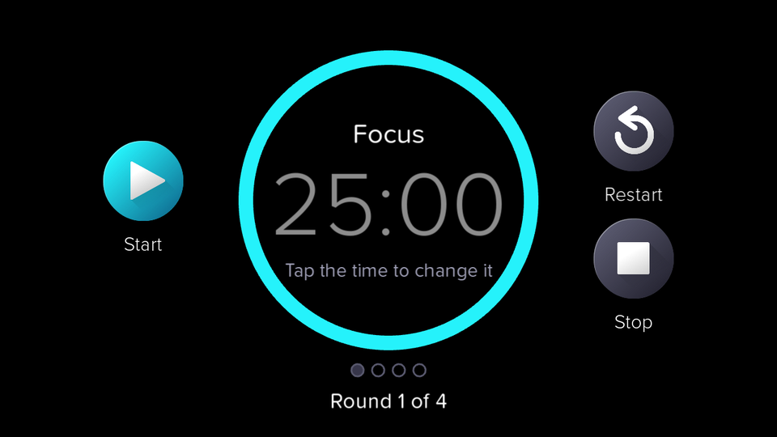
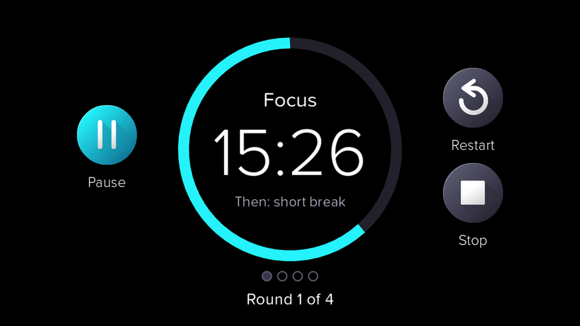
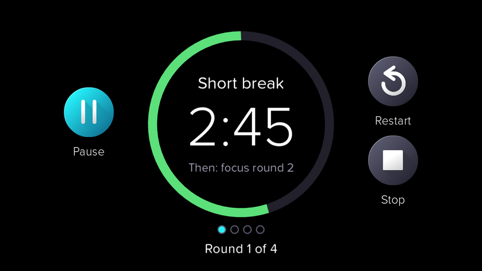
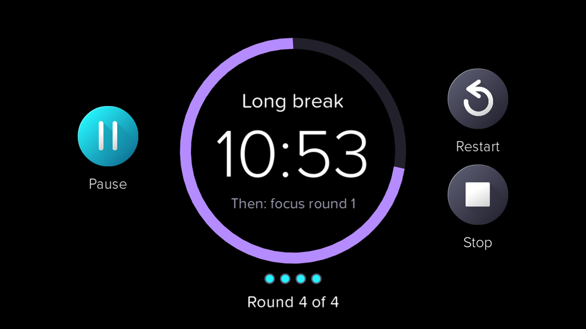
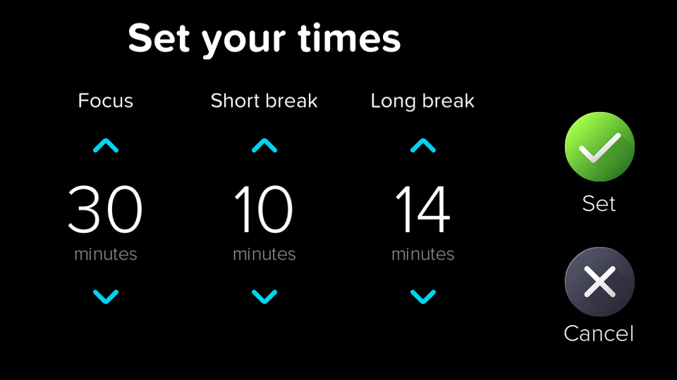

# Pomodoro

A focus timer for Jibo, built on the Pomodoro technique: work in focused rounds, take short breaks between them, and take a longer break after every fourth round. Jibo keeps time on his face and tells you when to rest and when to get back to it.

## How it works

1. Open **Pomodoro** from Jibo's main menu.
2. Tap **Start**. Jibo says, "Let's focus for 25 minutes."
3. The ring empties as time runs down: **cyan** for focus, **green** for a short break, and **purple** for the long break.
4. When a round ends, Jibo announces the break and the next phase starts automatically. The dots at the bottom show which of the four rounds are done.

## Controls

- **Start / Pause** (left button): start or pause the timer.
- **Restart**: restart the current focus round or break.
- **Stop**, or swipe down: leave Pomodoro.
- **Tap the time** to set your own lengths. Use the arrows to change each one a minute at a time, then tap **Set** to save or **Cancel** to keep the old times.

## Times

- **Focus:** 25 minutes by default, adjustable from 1 to 90 minutes.
- **Short break:** 5 minutes by default, adjustable from 1 to 30 minutes.
- **Long break:** 15 minutes by default, adjustable from 1 to 60 minutes.

Your times are saved on the robot and used the next time you open Pomodoro. If you change them during a round, the current countdown keeps going and the new lengths start with the next phase.

## Requirements

5x1 3.1.7 or newer. Works offline; no account or internet connection needed.
